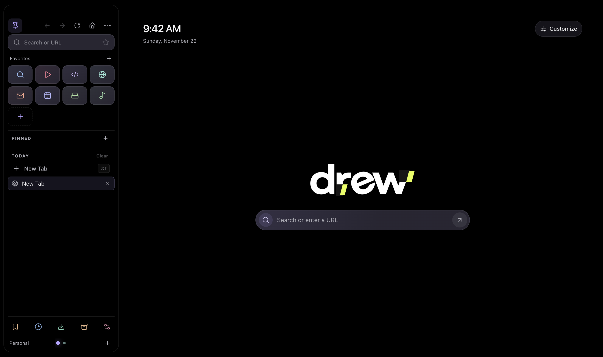
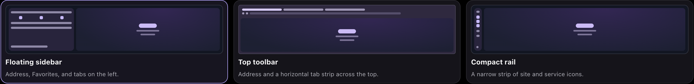

<div align="center">
  
  <h1>Drew Browser</h1>
  <p><strong>A workspace browser for macOS and Windows.</strong></p>
  <p>Swipe between projects, keep your accounts separate, and put the web first with a floating sidebar.</p>
  <p><a href="#get-drew"><strong>Download Drew</strong></a> · <a href="#screenshots">Screenshots</a> · <a href="#how-drew-is-organized">How Drew works</a> · <a href="#build-and-test">Build and test</a> · <a href="#support-drew">Support Drew</a></p>
</div>

## Get Drew

Installers will appear under **Assets** on the [Drew releases page](https://github.com/Lekshan-Rajapaksha/drew/releases) once they’re published.

| Platform | Installer to look for |
| --- | --- |
| macOS 13 or newer, Apple Silicon | `Drew-<version>-arm64.dmg` |
| macOS 13 or newer, Intel | `Drew-<version>-x64.dmg` |
| Windows 10 or 11, x64 | `Drew-Setup-<version>-x64.exe` |

See [release status](#release-status) for signing and platform validation.

You can also build from source with [Node.js](https://nodejs.org/) 24.15 or newer. On macOS, install Xcode Command Line Tools for the native trackpad monitor.

```sh
git clone https://github.com/Lekshan-Rajapaksha/drew.git
cd drew
npm ci
npm run dev
```

Fresh Profiles start with **Personal** in True Black and **Work** in Light. Open **Settings → Appearance** to change the navigation layout, theme, gradient, and motion preferences.

## Screenshots





Screenshots use a fresh test Profile on macOS.

## How Drew is organized

| Feature | How it works |
| --- | --- |
| **Floating sidebar** | Move to the left edge to reveal the sidebar over the page. Pin it when you want the webpage to reserve room for it. You can also pick a compact sidebar or a horizontal toolbar. |
| **Spaces and Profiles** | A Space holds the tabs, folders and split layout for a project. A Profile owns cookies, logins, permissions, history, Favorites, and browser settings. Give a client a dedicated Profile or use several Spaces with the same account. |
| **Favorites, Pinned, and Today** | Add websites to the Favorites grid and drag to reorder. Drew shows a favicon when the website provides one. Pin long-lived tabs and organize them in nested folders. Today tabs can auto-archive, and the archive supports search, batch restore, and **Undo Clear**. |
| **Command Bar** | Search the web, switch tabs, jump to browser tools, and run actions such as Split View, Save as PDF, and Export Workspace. |
| **Split View and previews** | Browse with up to four resizable panes. Press Left or Right on a focused divider to adjust it, or hold Shift for a larger step. Link previews show their destination and can open in a full tab. |
| **Window recovery** | Quit and reopen Drew to restore open windows, tabs, and split layouts. Same-Profile tabs in other windows are visible under **Other windows**. |
| **Per-Profile appearance** | Choose from light, dark, and colored themes. Change gradient colors, intensity, Favorites icon size, the homepage, and new-tab clock and suggestions. |

On macOS, two-finger horizontal swipes over the sidebar use native gesture phases. The sidebar follows the gesture while the page stays in place. Windows uses a wheel-event fallback. Use the bottom Space buttons to switch with a mouse or keyboard.

## Everyday browsing

- Use the sidebar footer or browser menu to open bookmarks, history, downloads, archived tabs, and Settings.
- The address bar’s site-information button shows the current origin and its connection status. Camera, microphone, and notification rules are managed per Profile.
- Downloads show progress and support pause, resume where supported, and retry for eligible HTTP(S) transfers. Use **Reveal** to find completed files.
- Use the tab context menu to move a tab to another Space in the same Profile or into a new window. Moving to a new window reloads the page.
- When a page is open, **Save Page as PDF** is available in the Command Bar. The page context menu also includes standard actions for links, images, text, and editing.

## Keyboard shortcuts

| Action | macOS | Windows |
| --- | --- | --- |
| Open Command Bar | ⌘ T | Ctrl + T |
| Focus address | ⌘ L | Ctrl + L |
| New window | ⌘ N | Ctrl + N |
| New private window | ⌘ Shift + N | Ctrl + Shift + N |
| Toggle sidebar | ⌘ S | Ctrl + S |
| Open Split View | ⌘ Shift + D | Ctrl + Shift + D |
| Find in page | ⌘ F | Ctrl + F |
| Print page | ⌘ P | Ctrl + P |
| Zoom in, out, or reset | ⌘ +, −, or 0 | Ctrl +, −, or 0 |
| Reopen closed tab | ⌘ Shift + T | Ctrl + Shift + T |
| Fill saved login | ⌘ Shift + L | Ctrl + Shift + L |

Edit supported bindings in **Settings → Keyboard Shortcuts**.

## Bring your browsing setup

1. Open **Settings → Import**. Choose a detected Chromium browser or select a Profile folder. Drew previews the items and matching destinations before importing.
2. For Arc or Dia, choose **Import Profiles or Spaces** and select a Markdown export. Drew imports supported tabs, Favorites, pinned folders and available colors.
3. To move passwords, export a CSV from each source Profile and select its destination in Drew. CSV files contain readable passwords and stay where you saved them. The format carries passwords and usernames. Passkeys and signed-in sessions require their own migration path.

For a portable collection of links, use **Export workspace as bookmarks HTML**. To preserve the current Space’s tabs, nested folders, pin state, selected tab and split sizes, choose **Back up this Space**. Restoring a backup previews the destination and creates a new Space in the selected Profile. Space backups exclude passwords, cookies and browsing history.

**Settings → General** can route external links from exact hostnames into a chosen Profile. For example, route `mail.example.com` to Work.

## Performance and privacy

- **Memory Saver** unloads eligible background pages while keeping their tabs. Clicking a sleeping tab reloads the page. You can also sleep a background tab manually.
- **Battery Saver** reduces browser motion and lowers the idle threshold for tab sleeping. Choose **On battery** or **Always on** in Settings.
- **Keep sites awake** excludes specified hostnames from automatic sleeping and archiving. Both automatic actions preserve tabs with detected edits, active media or capture, sign-in popups, and other protected activity.
- **Private windows** use in-memory tab history and site storage. Files you download or explicitly save remain on disk.
- **Resource host rules** block embedded requests to explicitly listed hostnames within a Profile. They use your list and apply to new requests.
- **Passwords** are saved through the OS-backed vault. Open Passwords while browsing an HTTPS site to prefill its origin, or use **Edit password** on an existing account. Autofill checks the active Profile and the page before filling an eligible login form.

Drew uses sandboxed Chromium views, context isolation, and OS-backed password encryption. Credential entries are tied to the Profile, origin, and account. macOS uses Keychain and Windows uses DPAPI. Browsing data and workspace backups are local. Password encryption does not encrypt exported links or your browsing history.

## Build and test

| Command | Result |
| --- | --- |
| `npm run dev` | Build and launch Drew |
| `npm run build` | Compile Electron and bundle the React interface |
| `npm run lint` | Run ESLint |
| `npm run typecheck` | Check Electron and renderer TypeScript |
| `npm test` | Build and run the unit suite |
| `npm run test:desktop` | Launch desktop tests with temporary Profiles and loopback fixture sites |
| `npm run dist:mac:arm64` / `npm run dist:mac:x64` | Build Apple Silicon or Intel Mac packages |
| `npm run dist:win` | Build Windows x64 packages |

The browser shell is React and TypeScript. Electron hosts the shell and the Chromium page views. SQLite stores workspace, history, and Profile metadata. Most browser controls live in `src/`, the native window and browser services live in `electron/main/`, and shared types and shortcuts live in `shared/`.

The desktop suite covers navigation, downloads, Profile isolation, window and split recovery, import and autofill fixtures, and sidebar gestures. Set `LEXN_TEST_PUBLIC_WEB=1` for an optional live-web smoke test. Use `tests/packaged-smoke.mjs` with an inspector-enabled QA package to exercise relaunch and upgrade. Production packages disable the inspector.

### Release status

Run `npm run release:signed` on the target OS with production credentials. macOS requires a Developer ID Application identity and notarization credentials. Windows requires Authenticode signing and `DREW_WINDOWS_PUBLISHER`. Set `DREW_UPDATE_URL` to the platform’s HTTPS stable release directory. Publish the signed artifacts and blockmaps before publishing the matching update manifest. Verify an installed upgrade, failed-download recovery, default-browser handoff, and Profile retention on both platforms. [Electron Builder update documentation](https://www.electron.build/docs/features/auto-update/)

Public distribution still needs an end-to-end signed update and recovery run. Native Windows and Intel Mac testing, screen readers, DRM, screen sharing, inline PDFs, live account sign-in, and passkeys still need wider compatibility coverage. Extensions have Electron’s unpacked-extension support. Chrome Web Store installation, cross-device sync, automatic credential-capture prompts, and site and download reputation services are outside the current feature set. [Supported extension APIs](https://www.electronjs.org/docs/latest/api/extensions)

## Support Drew

If you use Drew, you can help by [starring the project on GitHub](https://github.com/Lekshan-Rajapaksha/drew), sharing it, or [reporting an issue](https://github.com/Lekshan-Rajapaksha/drew/issues/new).

<!-- Add the maintainer’s verified Buy Me a Coffee link here once it is available. -->

### Report an issue

Include your Drew version from **Settings → About**, your operating system, the steps to reproduce the issue, and the expected behavior. For layout issues, include the chosen navigation layout and whether the sidebar was pinned. For import issues, describe the source browser and file format. Share test files with sample data. [GitHub Issues](https://github.com/Lekshan-Rajapaksha/drew/issues)

When comparing efficiency, use the same device, workload, display brightness, and tab count. Measure wakeups, memory, power, and frame times separately. Local tests verify browser behavior and give useful before-and-after measurements. Comparative battery runtime has not been measured.
